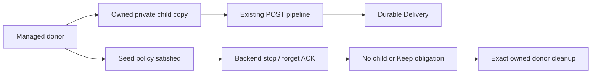

# BitTorrent release review — single-node release candidate

**Status:** single-node implementation complete; consolidated review and fast
qualification remain ·
**Decision:** maintained rqbit M0 and independent review are accepted; M2–M4
are implemented on the consolidated branch and M5 owns final qualification ·
**Owner:** ADR-19 in [BITTORRENT_PROPOSAL.md](BITTORRENT_PROPOSAL.md)

**2026-09-20 magnet-discovery amendment:** DHT-enabled sessions now resolve
privacy-unknown v1 magnets in list-only mode, then reject private metainfo
before managed admission. This makes public trackerless magnets usable, but a
hash may already have been queried publicly before the private bit is known.
The setting remains off by default, and SOCKS plus DHT still fails closed.

This is the short operations and release-review surface for nzbd's BitTorrent
backend. It tells a reviewer what network traffic, ports, storage, seeding,
deletion, native API, and qBittorrent-compatible behavior the implementation
owns. It is not a substitute for the executable release evidence.

## 1. Decision at a glance

| Review area | Current truth | Condition for release |
|---|---|---|
| Production reachability | `[torrent].enabled = true` starts one maintained session, admission route, watch scanner, backend executor, and bounded shutdown path | Consolidated adversarial review and fast qualification must pass before merge |
| Public observability | **M0 pass** — required facts and bounded error are exposed; unavailable tracker/DHT diagnostics are explicit `unknown` | M2 state, API, and UI contract tests must preserve that honest boundary |
| Authoritative restore | Queue-authorized descriptors restore paused-first under only the configured default/category roots; pending secret sidecars reconcile independently | Restart and containment evidence remains green |
| Resource and dependency decision | **M0 pass** — accepted limits and refreshed measurements are green on all five native targets | The maintained series and accepted limits in [BITTORRENT_GATE9_REVIEW.md](BITTORRENT_GATE9_REVIEW.md) must stay green across the native matrix |
| Adversarial M5 work | In progress | The remaining resource, mounted-filesystem, production shutdown, auth-limiting, and sustained-fuzz evidence is green |
| Operator action today | Leave disabled unless the peer port, immutable payload root, seeding policy, and public-discovery implications are understood | The Settings warnings and this review agree with the running configuration |

The release decision is conjunctive. Passing one row never compensates for a
failed row, and a green workflow never changes the recorded gate state by
itself.

## 2. Public traffic

### Current boundary

The production daemon starts no peer listener, tracker client, DHT node, PEX
exchange, or payload transfer while BitTorrent is disabled. Enabling it starts
one TCP/IPv4 session with the configured port and discovery policy. Local
discovery and UPnP remain unavailable, and cluster plus torrent is rejected.

### First-release contract

| Traffic | Public v1 torrent | Private v1 torrent |
|---|---|---|
| TCP/IPv4 peers | Inbound on the configured peer port and outbound to discovered peers | Allowed only after private policy is known |
| HTTP(S) trackers | Allowed; secrets and queries stay redacted | Only the one validated metainfo tracker in the first release |
| UDP trackers | Allowed only without a SOCKS proxy | Same validation rule; proxy plus UDP fails closed |
| PEX | Enabled by default for public torrents | Disabled regardless of operator settings |
| DHT | Disabled by default; when enabled, may query unresolved magnet hashes and can resolve trackerless public magnets | Known-private metainfo is never handed to DHT; metadata found after an unknown-hash lookup is rejected before admission |
| Local discovery (LSD) | Disabled by default | Disabled regardless of operator settings |
| UPnP | Unavailable | Unavailable |

An unresolved magnet is privacy-unknown. When DHT is enabled, nzbd permits the
public lookup needed by trackerless magnets, resolves metadata in list-only
mode, validates the requested info hash and all metainfo limits, and only then
admits public content. A private result is rejected, but that cannot erase the
earlier hash lookup. A proxy covers eligible TCP peer and HTTP(S) tracker
traffic only; it is not a VPN kill switch or an anonymity guarantee.
Deployments that require forced routing must enforce it in the host or
container network namespace and firewall.

**Reviewer acceptance:** packet capture must show the expected public controls,
known-private metainfo is never handed to DHT/PEX/LSD, and no direct UDP path
exists for a proxied job. An unknown magnet hash may already have crossed DHT
before resolved metadata proves it private; that result must be rejected before
managed admission. Logs and the Settings UI must display the redacted traffic
policy before a session starts.

## 3. Ports

The first release owns exactly one explicit TCP/IPv4 peer
port, defaulting to `6881` only after the feature is deliberately enabled.
There is no port range probe, random fallback, ephemeral port, automatic
router mutation, or UPnP. Failure to bind the configured port is a startup
failure for the torrent feature, not permission to choose another port.

DHT remains off by default. Enabling it opens UDP discovery egress and permits
pre-metadata hash lookup; the Developer settings advisory and
[CONFIGURATION.md](CONFIGURATION.md) state that consequence before restart.

**Reviewer acceptance:** the startup summary, Settings UI, container examples,
and firewall guidance must agree on every inbound and outbound transport. An
upgrade with torrent support disabled must open no new socket.

## 4. Paths

The production daemon consumes `paths.torrent_dir`,
`paths.torrent_watch_dir`, and category overrides only while enabled. The
storage contract separates immutable seed payloads from the
existing completed-media destination:

| Path role | Required behavior |
|---|---|
| Torrent payload root | Dedicated, canonicalized root; validated relative content only |
| Completed-media root | Existing import/post-processing destination; never silently used as the seed root |
| Category override | Must remain inside an authorized root and preserve the same portable path rules |
| *arr-visible path | The path nzbd reports must be mounted identically in nzbd and the media manager |

The adapter rejects traversal, symlinks declared by metainfo, unsafe
existing prefixes, duplicate or prefix-overlapping files, reserved Windows
names, and portable Unicode/case aliases before storage construction. The
hosted native probes describe their temporary filesystems; they do not prove
descriptor-relative containment or every filesystem used by operators.

The isolated crate-private fault harness covers two engine paths. Its write-time
proof injects storage exhaustion after one successful piece write; an
already-live filesystem-backed control must remain live across that boundary
and complete without changing the faulted torrent's state or write accounting.
The test-only seeder is rate-limited and lets rqbit bind the first available
port directly, avoiding speed-dependent and temporary-port handoff races.
Stable rqbit reports that torrent as `Error`, not the proposed disk-paused
state.

The historical initialization-time proof injected `StorageFull` from
`ensure_file_length`. Unmodified stable rqbit emits a warning log but does not
put the failure into torrent stats: a zero-byte file reports successful paused
initialization and moves to `Live` on resume without a stats error or retry
before that observation. The
[2026-08-13 replacement run](https://github.com/pjunod/nzbd/actions/runs/31654021866)
reproduced it on all five native targets with one 262,144-byte sizing request,
a zero-byte file, zero piece writes, and no stats-visible error. The daemon now
has a protocol-neutral multi-root enforcing guard, cluster placement hold, and
local/per-node limiting-volume status, but neither proof routes a torrent fault
into it. They therefore do not establish operator-visible torrent ENOSPC
behavior and do not authorize production wiring.

Maintained stable patch `0018` propagates the first selected-file sizing error
out of initialization, with an exact unit proof and mutation-sensitivity
check. The current-main contribution variant also distinguishes typed checksum
cancellation from real I/O failure so an overlapping pause cannot hide storage
exhaustion. The maintained fix closes the engine fail-open boundary; it does
not replace M2's required torrent fault-routing, pause, and recovery policy.
The native harness now treats the historical `Paused`-then-`Live` result as a
failure: admission or initialization must expose the bounded file, length, and
storage cause, and any asynchronously returned handle must enter `Error`.

**Reviewer acceptance:** supported deployment examples must exercise the
actual bind mounts or volumes, case/normalization behavior, low-space guard,
symlink race boundary, import path, and restart authority. Until that matrix
is green, adapter path preflight is defense in depth rather than an operator
mount guarantee.

## 5. Seeding

Managed acquisition amendment: ordinary existing torrents retain the seed-limit
behavior described below. A newly owned managed donor may retire after its
configured policy completes only when the backend has acknowledged stop and
forget, no acquisition child still depends on it, and current Keep/recovery
obligations permit exact cleanup. A seed-limit observation alone authorizes no
unlink. Explicit DeleteFiles remains a separate exact operator action.




The queue owner checkpoints cumulative uploaded bytes and seeding time, applies
per-add → category → global limits at exact boundaries, and pauses without
deleting payloads.

The first-release contract marks a verified torrent `ready` while it may still
seed. The default seed ratio and seed time are unlimited until the caller or
operator chooses a limit; nzbd must warn about an unlimited active seed rather
than invent a potentially tracker-hostile default. Reaching a ratio or time
limit pauses seeding and retains data. It never silently deletes payloads or
races the media manager's import.

Upload limits, achieved ratio/time, current upload rate, and paused-seed state
must be visible through the native API/UI and the supported qBittorrent
compatibility projection. Private tracker policy remains authoritative.

**Reviewer acceptance:** docs and examples must distinguish readiness,
seeding, paused seeding, import, and removal. A seed-limit test must prove that
the payload still exists and that explicit resume or removal remains possible.

## 6. Deletion

Deletion is always an explicit caller choice after the torrent handle is
stopped:

| Operation | Control-plane result | Payload result |
|---|---|---|
| Forget, keep data | Remove live metadata/control and write terminal history | Retain the validated payload and report its location |
| Forget, delete data | Remove live metadata/control and write terminal history | Remove only the persisted, authorized torrent content |

The isolated adapter proves idempotent keep/delete calls and retention of an
unrelated sibling. That is not the complete production proof: the durable job
must own the authoritative delete root, restart reconciliation must not widen
it, open handles must be stopped, and every refusal or partial failure must be
visible. A seed limit never implies either deletion operation.

**Reviewer acceptance:** restart, missing-file, symlink, external-move,
read-only, and partial-delete cases must leave honest history and must never
remove a sibling, parent, completed-media import, or path outside the durable
root.

## 7. Release evidence

Run the deterministic gate before every review:

```sh
make gate
```

Run the bounded local fuzz campaigns when the pinned nightly toolchain is
available:

```sh
make gate-fuzz
```

The release reviewer also checks the native and security evidence rather than
relying on one local host:

| Evidence | Last recorded proof |
|---|---|
| Historical maintained v8.1.1 archive and then-current nine-patch series | [2026-08-14 maintained-rqbit workflow](https://github.com/pjunod/nzbd/actions/runs/31837867809); this does not qualify the 2026-09-20 eleven-patch head |
| Current eleven-patch derivation and magnet-DHT regressions | Not yet recorded; see [BITTORRENT_MAGNET_DHT_STATUS.md](BITTORRENT_MAGNET_DHT_STATUS.md) for the merge gate |
| Native 100-torrent admission/shutdown pressure | [2026-08-09 matrix run](https://github.com/pjunod/nzbd/actions/runs/31330178035) |
| Private DHT/LSD packet capture | [2026-08-06 capture run](https://github.com/pjunod/nzbd/actions/runs/31128106994) |
| Cross-platform filesystem behavior | [2026-08-08 probe run](https://github.com/pjunod/nzbd/actions/runs/31240896567) and [review correction](https://github.com/pjunod/nzbd/actions/runs/31264422471) |
| Native adapter matrix, resource measurements, and daemon isolation | [2026-08-14 maintained-engine M0 run](https://github.com/pjunod/nzbd/actions/runs/31837867629) |
| Write-time storage-fault containment | [2026-08-10 hardened five-platform run](https://github.com/pjunod/nzbd/actions/runs/31345445318) |
| Initialization-time storage-fault boundary | Historical fail-open witness: [2026-08-13 replacement five-platform run](https://github.com/pjunod/nzbd/actions/runs/31654021866); maintained fail-closed proof: [2026-08-14 M0 run](https://github.com/pjunod/nzbd/actions/runs/31837867629) |

These links are evidence snapshots, not evergreen approval. The reviewed
commit must have its own green required checks.

## 8. Sign-off and stop conditions

Before any production wiring PR can be approved, the reviewer records all of
the following:

- All eleven M0 gates pass for the exact maintained engine on every supported
  native target, with checksum/series/vendor integrity and independent review.
- Gate 9's resource ceilings, measurements, and dependency exceptions remain
  accepted and enforced.
- The remaining M5 resource, filesystem, shutdown, auth, and sustained-fuzz
  work is executable and green.
- Public/private captures match §2 and every port is visible before startup.
- Supported operator mounts pass the path, disk-full, restart, and deletion
  matrix.
- Seed limits pause without deleting, while explicit keep/delete behavior is
  correct and visible.
- Disabled upgrades open no peer socket and admit no torrent.
- Rollback and downgrade drain/export steps have been exercised.

This document's drift check pins the selected maintained engine, the
eleven-gate M0 evidence, and the active single-node boundary. Any future engine,
network, cluster, or compatibility expansion must update the proposal, M0
report, this review, and the check together. Bypassing the check is not a
substitute for that decision.
