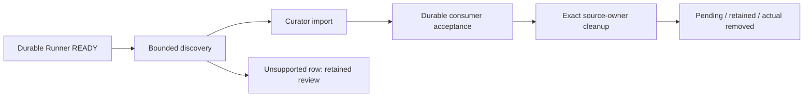

# Curator delivery — durable publication and receipt protocol (draft)

**Status:** superseded by [PIPELINE_CONTRACT.md](PIPELINE_CONTRACT.md) — 2026-11-07

Companion to [INTEGRATION.md](INTEGRATION.md) (the app boundary) — this is
the restart-safe contract for transferring one completed Runner publication to
Curator.

> **Draft, not deployment-ready.** The API and storage implementation are
> under review. Do not enable an integration against this protocol until the
> contract tests and both applications' end-to-end checks have passed.

## The ready record owns handoff discovery

History and `job_pp_finished` remain useful for observation, but neither owns
handoff custody. A user can hide a history row, and a process can stop after
publishing files but before recording history. Runner therefore writes one
immutable delivery record for each publication generation. The record remains
queryable by ID for as long as it is retained. Since contract v2 (runner
0.3.0) Runner keeps no acceptance state: `accept` answers 200 and changes
nothing, and nothing in Runner (cluster included) waits on it. Rows accepted
by an older build keep their `acceptedAt` and stay out of the default scan.

The lifecycle is:

```text
completed payload
      │ publish and sync
      ▼
durable manifest + ready Delivery + target custody transfer (one DB commit)
      │                                  │
      │                                  └── source cleanup retries independently
      ▼
Curator verifies the manifest and imports, keyed on its own transfer row
      │
      ▼
(optional) Curator posts accept — a 200 no-op kept for old consumers
```

The ready commit changes the published artifact to `state="transferred"` and
`owned=false`, in the same SQLite transaction that inserts the Delivery. This
fences Runner deletion and retention of Curator's publication. Runner's
original source copy is a separate artifact generation and is retired only
after the Delivery row is durable. Curator acceptance and source cleanup are
independent outcomes: a receipt does not wait for cleanup, and cleanup may
finish before Curator posts its receipt.

## `GET /api/v1/deliveries` discovers ready records

The endpoint uses the same configured HTTP Basic or Bearer credentials as
Runner's other API routes. `X-Nzbd-Client` and `User-Agent` are observational
headers, never authentication. The current API credential is installation-wide
and does not yet bind a receipt to a distinct Curator instance.

```http
GET /api/v1/deliveries?after=0&limit=50
Authorization: Bearer <configured Runner API token>
```

`after` is a durable monotonic sequence cursor. `limit` is 1–100 and defaults
to 50. The response shape is:

```json
{
  "protocolVersion": 1,
  "deliveries": [
    {
      "protocolVersion": 1,
      "sequence": 23,
      "status": "ready",
      "deliveryId": "artifact-id:generation-id",
      "kind": "completed",
      "publicationGeneration": "generation-id",
      "artifactId": "artifact-id",
      "sourceArtifactId": "source-relocation-id",
      "sourceGeneration": "source-generation-id",
      "jobId": 123,
      "runnerInstanceId": "installation-id",
      "requestToken": "original-monarr-transfer-token",
      "publicationPath": "/downloads/completed/release",
      "manifestDigest": "lowercase-sha256-hex",
      "files": [
        {"path": "Season 1/Episode.mkv", "sizeBytes": 1234, "sha256": "lowercase-sha256-hex"}
      ],
      "fileOutcomes": [
        {
          "sourcePath": "release.rar",
          "publicationPath": null,
          "classification": "archive_input",
          "outcome": "consumed",
          "reason": "verified extraction published",
          "sourceCleanupStatus": "pending"
        }
      ],
      "readyAt": 1792670400,
      "acceptedAt": null,
      "consumerReceiptId": null,
      "sourceCleanup": {
        "status": "pending",
        "error": null,
        "attempts": 0,
        "nextRetryAt": null,
        "blockedSince": null,
        "warning": null,
        "startedAt": null,
        "lastAttemptAt": null,
        "completedAt": null
      }
    }
  ],
  "nextCursor": 23,
  "cursorRule": "Rescan with after=0 each sweep, or durably persist every returned delivery before advancing the cursor."
}
```

`kind` is `completed` for a successful job's publication and `salvage` for
the part of a failed job Runner could still verify and publish (contract
§2.2). A salvage delivery carries the same manifest body — `manifestDigest`
and `files` — as a completed one; Curator decides whether to import it.

The server scans sequence rows, including accepted rows, and returns only
unaccepted rows in `deliveries`. `nextCursor` is the last sequence scanned;
when there are no rows after `after`, it equals `after`. Pending records are
never deleted or hidden by a newer accepted record. Curator must either scan
from zero on every sweep or persist every returned row before advancing a
cursor. That rule prevents a failed older import from being stranded after a
newer sequence is accepted.

`includeAccepted=true` returns both pending and accepted rows for status
refresh. `GET /api/v1/deliveries/{deliveryId}` returns one durable row with
the same immutable publication fields and the latest acceptance and source
cleanup fields, including after acknowledgement. Curator can use it to refresh
source cleanup without rediscovering or reimporting the payload.

## Transfer-token admissions are durable

Runner advertises `request-token-idempotency-v1` in
`GET /api/v1/status.capabilities`. Curator sends one nonempty
`monarr-transfer` value when submitting a URL job. Runner atomically persists
the token, a SHA-256 fingerprint of the canonical submission, the original
job ID, a generation ID, and the latest observed outcome before starting its
fetch. The tombstone lives in the queue snapshot and is independent of the
visible queue and history, so it survives failed jobs, history clearing, and
restart. Tombstones are retained for the life of the Runner state; history
cleanup never prunes them.

Exact replay returns the original job ID and does not start another fetch. A
changed submission under that token returns `409 Conflict`; an empty or
duplicate `monarr-transfer` parameter is rejected. A deliberate new grab
uses a new token. Curator can recover the terminal outcome after a retry or
restart with the authenticated lookup:

```http
GET /api/v1/request-admissions/{transferToken}
Authorization: Bearer <configured Runner API token>
```

The response includes `protocolVersion`, `requestToken`, `jobId`,
`generation`, stable `runnerInstanceId`, and `outcome`, plus nullable
`terminalOutcome`, `failureStage`, `failureCause`, and `publicationPath`,
`custodyState`, `keepSourceOnFailure`, nullable `sourceCleanupStatus`, and
nullable `sourceArtifactId`/`sourceGeneration`. The source fields identify a
Runner-owned retained processing generation when no Delivery was created, or
the Delivery's separate source generation when partial payload was published.
They are distinct from `artifactId` and `publicationGeneration`.
`terminalOutcome` is present only after a durable terminal PP stamp; a merely
completed queue status is not evidence that post-processing succeeded.
`custodyState` comes from explicit artifact or Delivery evidence; `deleted`
queue status alone never proves the bytes were removed. Values currently
include `runner_owned`, `curator`, `deleted_by_runner`, `kept_by_user`, and
`no_payload`. A partial salvage can have `terminalOutcome=FAILURE/HEALTH`
while custody is `curator`; the verified publication transferred and the
failed source remains separately Runner-owned. `sourceCleanupStatus` reports
that separate source-retirement outcome. A retained no-Delivery source is
available through `sourceArtifactId`/`sourceGeneration` for Resolve or an
explicit source-scoped action. The URL is never included. A missing token
returns 404.

`keepSourceOnFailure` is an explicit per-download choice, off by default. It
preserves unresolved failed material; verified files and resolved duplicate
source bytes can still be retired under the ordinary per-file cleanup rules.
Legacy global failure actions do not implicitly opt a new delivery into Keep.

`runnerInstanceId`, `jobId`, and `requestToken` are correlation evidence.
`requestToken` is the original `monarr-transfer` value sent before Runner
admission; Runner does not mint a replacement during handoff. Curator must
match the authenticated Runner installation, job handle, and exact transfer
token. A missing or ambiguous association remains unresolved; consumers must
not guess a primary library copy from a title or path.

`publicationPath` is descriptive. Curator must read the manifest's relative
paths under the configured Runner publication root and must reject paths that
escape it. Each file's size and byte digest are independently verified while
streaming it; directory entries are not part of the manifest.

`files` contains only selected payload files. Runner stages and publishes that
subset from a private tree after post-processing scripts finish, while the
complete source tree remains separately owned until READY is durable and its
files are resolved. `fileOutcomes` is additive and source-relative: every
regular source file has a `sourcePath`, an optional target-relative
`publicationPath`, a `classification`, an `outcome`, and an explanatory
`reason`. Curator may ignore this field when importing, but it must not treat
it as part of the manifest digest.

`repairDependency` is independent of `outcome`. When true, the source file is
an exact member of a measured, generation-bound PAR set with enough recovery
blocks for the diagnosed damage. Runner keeps that source member and the
measured set inputs even if a verified sibling is also published; a later
repair attempt must produce fresh evidence before those dependencies become
disposable.

Runner publishes the same recognized video (`.mkv`, `.mp4`, `.avi`, `.m4v`,
`.mov`, `.wmv`, `.ts`, `.webm`), audio (`.m4b`, `.m4a`, `.mp3`, `.aac`,
`.flac`, `.ogg`, `.opus`, `.wav`, `.wma`), and native-book (`.epub`, `.azw3`,
`.azw`, `.mobi`, `.pdf`, `.cbz`, `.cbr`, `.djvu`) formats that Curator imports,
plus paired subtitle, NFO, and established cover art sidecars. Explicit
`.sample`/`-sample`/`_sample`, bracketed `[proof]`/`(proof)` filename tags,
and files under `Sample/` or `Proof/` directories are excluded. Ordinary
`Sample` and `Proof` titles remain eligible, including `Burden.of.Proof.mkv`,
`Living_Proof.flac`, and `Proof.epub`. Samples and disposable temp inputs are
excluded. Native EPUB, CBZ, and CBR containers remain payloads: ZIP/RAR magic
never renames them into extraction inputs. An archive is marked
consumed only when the transform journal proves its extraction was published.
Extraction and repair outputs keep their proof across Runner's own later
renames (PAR naming restoration and the final deobfuscation pass, which gives
an obfuscated `<hash>.mkv` and its `<hash>.partNN.rar` volumes the release
name): the rename journal records each file's complete identity immediately
before the rename and a digest of its bytes, and an output is followed to its
new name only when that pre-rename identity is exactly the one the transform
journal recorded and the current bytes still match the digest. Consumed archive
inputs need the exact identity the extraction bound, at the bound path or
carried by the rename journal, and an archive whose every volume is already
proven consumed is not extracted again on retry. When nothing is
publishable, the held job says `nothing publishable:` and names the payload
files found and what each one lacks.
Nested or unconsumed archives and unknown files stay in Runner's source tree
when they remain unresolved after a partial publication. A failed job is
retained for recovery only when Runner has a concrete retry or repair reason;
the mere presence of an archive, unknown extension, or PAR file does not prove
that recovery is viable. Terminally unusable work follows its explicit Keep
choice or the new-work default disposition. An attempt that left no source
files at all (a health failure before any file finished) has nothing to
recover and is disposed like any other unusable source. The 30-second
file-lifecycle tick also disposes any retained failed source whose directory
has no entries at all, unless Keep is set, through the same generation-bound
`failed-delete-<artifact>` operation that clearing Keep uses. An `unknown`
assessment still retains: it covers complete payload files whose segments all
finished but whose poster supplied no whole-file CRC, which are salvageable.

A retained failed source is pinned into its request receipt
(`sourceArtifactId` / `sourceGeneration`), and every receipt lookup refreshes
`custodyState` from that exact generation. Curator holds a replacement while
custody is `runner_owned`, so this pin is what lets a later disposal, delete,
or Keep reach Curator. Receipts written before the pin existed adopt the
allocation this installation recorded for the same job on their next lookup.
A pinned source that the lifecycle sweep finds missing under a verified root
(`source_gone`) settles the receipt like a delete: nothing is left in Runner
custody.

### Bounded repairability assessment

This assessment has no generic health-percentage threshold. Runner takes a
rooted source-manifest snapshot, capped at 100,000 entries. Every regular
source entry is checked against its captured device, inode, size, modification
time, and change time before classification. Unknown names receive at most a
4 KiB signature read each; crossing the entry cap or failing a read blocks
cleanup with a named inspection fault. For each finalized NZB file Runner
checks that every segment is `Done` and no repair marker remains. When the
writer supplied an expected CRC32, it streams the file with a 64 KiB buffer
and confirms the CRC plus stable before/after identity. The
existing byte-count and SHA-256 checks remain authoritative for selected
published files. Extraction and PAR outputs require their journaled exact
identity and content digest. A mismatch is evidence against that output; a
missing CRC or missing transform record is only an evidence gap and is never
reported as success.

PAR discovery is capped at the same 100,000 source entries and 64 MiB of parsed
packet metadata. Invalid PAR packets do not establish recovery evidence;
storage read errors and a metadata-budget overrun block cleanup. Repairability
is calculated per matching set from its distinct available recovery exponents
and the actual damaged or missing slice count, using the set's slice CRCs and
zero padding for the last slice. A set with enough blocks runs automatic repair
in an isolated workspace before failed-health salvage. Runner validates the
repaired bytes against the PAR file descriptions and journals the exact outputs;
only those verified outputs can enter a delivery or qualify an archive for
extraction. A recognized archive signature by itself does not establish recovery.
If a tool cannot restore one measured repairable set, Runner records that
set's concrete repair fault, retains its source bytes and PAR support, and
still publishes independently verified siblings. A source-wide storage or
authority failure blocks the snapshot and enters the retry lane.
Password-required extraction and missing tools are named recoverable
conditions. Storage I/O and capacity failures are typed retry conditions,
never converted to corruption. Scans check cancellation between entries and
64 KiB data reads; there is no unbounded heuristic rescan within an attempt.
Extractor exit codes alone do not prove archive corruption: storage/access
errors and unrecognized tool failures retain the source for retry. Explicit
CRC, data, or archive-format diagnostics establish terminal extraction failure
when no matching repair path remains.
When overall download health fails, Runner still checks independent archive
sets. It extracts a set automatically only after every input volume has
finalized NZB segments and matching whole-file CRC or a validated PAR repair
output; extraction runs in a
private journaled workspace and must pass the volume-consumption check before
its output can join the selected delivery. Incomplete sibling sets are assessed
separately. A password failure names the password action, while an exhausted
extractor result without matching PAR recovery marks that set disposable.
If selected publication commits before its Delivery manifest, a durable
pre-publication outcome marker (including the health failure cause when
applicable) and the relocation journal let Runner finish that same publication
on restart without running extraction, repair, or scripts again. The failed
health path replays this receipt before inspecting the selected publication as
if it were a raw download source.
The durable retry lane repeats concrete transient conditions after 30, 60, 120,
then 300 seconds indefinitely. Diagnostic work interrupted by I/O/capacity or
an unavailable required tool retains the affected source and records that
cause. It does not claim unrepairability because a budget or retry count ended.

Runner selects only Curator-recognized media, native-book, and paired-sidecar
formats with positive direct CRC, extraction, or PAR output evidence. A
finalized NZB payload whose segments are all `Done` but whose writer supplied
no whole-file CRC is `unverified_review`: it is not published and stays in
Resolve with an explicit integrity-verification action. An archive not consumed by a
successful transform is `archive_review` only while a named transform retry,
password requirement, or matching repair path exists. An archive with positive
corruption/insufficient-repair evidence and no remaining path is eligible for
the default failed-work disposition unless Keep is selected. A file format
with no importer, transform, or parser is not retained under a generic review
label: its outcome records that no handler exists, and no unsupported file is
published. PAR inputs are retained only while the matching set has a verified
repair path. Failed-health assessment maps exact job-file IDs from the writer's
`.runner-file-N.part` layout to safe PAR catalog paths before counting damaged
slices. A repairable sealed partial and intact members needed by its set remain
source dependencies if repair fails. Complete old-style `.rNN` continuations
without a repairable first volume are unusable, rather than offering an
impossible extraction retry. Sidecars and folder art needed by a retained
payload remain with that source; unmatched sidecars and disposable junk drain
independently. Recognizable unknown usable files stay in Resolve with a named
verification, rename, or transform action. A completed attempt containing only
positively disposable inputs finishes as a failure and drains its owned source
unless Keep is selected. This policy does not authorize legacy backlog cleanup.
Deletion replay reads the durable deleted state before diagnosing source paths,
so a crash before the terminal history/stamp cannot strand an absent tree.

Recoverable I/O, missing-tool, capacity, and quota post-processing holds keep
the same source and admission receipt in Runner. New delivery jobs retry after
30, 60, 120, then 300 seconds, repeating with up to 10% positive jitter until
the storage or tool is available. Failed-source cleanup uses the same jitter
bounds. The absolute retry deadline and first blocked time survive restart;
after 30 minutes active scheduled retries show a warning while continuing.
Capacity and quota also use Runner's resource recovery lane. Identity conflicts
and uncertain outcomes remain in review rather than being retried blindly.
A configured-root mount mismatch is handled separately: Runner keeps writes
fenced and periodically checks the expected mount tuple, resuming only after
the configured source returns. It never adopts the directory exposed beneath
an absent mount. The request-admission tombstone refreshes source custody from
the exact artifact ID and generation after an explicit Keep or delete, so
Curator can reconcile actions taken after the visible queue/history row is
gone.
`sourceArtifactId` and `sourceGeneration` identify Runner's retained processing
source generation independently of the transferred publication artifact. They
remain queryable through Runner's artifact APIs and must be used for Resolve
or cleanup controls; Curator must never offer deletion of `artifactId` as a
Runner source action. Runner removes resolved source files independently and
keeps only unresolved files. Per-file `sourceCleanupStatus` reports `pending`, `removed`, or
`retained`; aggregate cleanup becomes `blocked` when an unresolved file needs
an operator action such as extracting the archive, adding format support, or
explicitly removing the file from Runner storage.

`POST /api/v1/deliveries/{deliveryId}/source-cleanup/retry` retries Runner's
source retirement after the storage is available or the operator has resolved
the blocker. It never changes the transferred publication. To remove a
retained source explicitly, Curator must first fetch `sourceArtifactId`, verify
that its `generation` still equals `sourceGeneration`, then submit the normal
revision-bound artifact deletion for that source artifact. The UI offers the
same operation with an undo window. The publication artifact is `owned=false`
and cannot be used for this action.

## Manifest digest is length-prefixed UTF-8

Each file SHA-256 is lowercase hexadecimal over the file bytes. Sort files by
the raw UTF-8 bytes of their slash-separated relative path. To hash the
manifest, concatenate these bytes with no JSON encoding or whitespace:

1. The ASCII prefix `runner-manifest-v1\n`.
2. For each sorted file: decimal UTF-8 path-byte length, `:`, path bytes, `\n`,
   decimal `sizeBytes`, `\n`, lowercase file SHA-256, and `\n`.

An empty file list is invalid. This encoding avoids JSON encoder differences
between Rust and Go, especially for HTML characters and Unicode separators.

The shared golden vector has two one-byte files, each containing `x`:

| Path | Size | File SHA-256 |
|---|---:|---|
| `z.mkv` | 1 | `2d711642b726b04401627ca9fbac32f5c8530fb1903cc4db02258717921a4881` |
| `é<&.mkv` | 1 | `2d711642b726b04401627ca9fbac32f5c8530fb1903cc4db02258717921a4881` |

The canonical bytes after the prefix are:

```text
5:z.mkv
1
2d711642b726b04401627ca9fbac32f5c8530fb1903cc4db02258717921a4881
8:é<&.mkv
1
2d711642b726b04401627ca9fbac32f5c8530fb1903cc4db02258717921a4881
```

The expected manifest digest is
`a0acee1d6757529c7deca3dc2ac2fa2f0b6e96db781d83b8d85d732cedd6459f`.

## `POST /api/v1/deliveries/{deliveryId}/accept` is a 200 no-op

Contract v2 moved the "is this delivered?" decision to Curator's own transfer
row, so Runner no longer records receipts. The route stays for consumers built
against protocol 1: any body (including none) on an existing delivery answers
`200` with the Delivery record unchanged — `acceptedAt` and
`consumerReceiptId` stay as they were (null for rows Runner 0.3.0 produced). A
delivery ID Runner does not know is `404`. Source cleanup, retention, and the
cluster's publication bookkeeping never wait on this call.

```http
POST /api/v1/deliveries/artifact-id%3Ageneration-id/accept
Authorization: Bearer <configured Runner API token>
```

## Source cleanup reports separately

`sourceCleanup.status` is `pending`, `running`, `retry`, `blocked`, or
`succeeded`.
`error` describes the last failed attempt, `attempts` counts attempts, and
`nextRetryAt` is a Unix timestamp when the retry is delayed. `startedAt` is the
first cleanup start, `lastAttemptAt` is the most recent attempt, and
`completedAt` is set only after source retirement is confirmed. A crash after
ready publication is recovered by the task runner; cleanup retries do not
re-publish the generation or change the immutable manifest. Any
`fileOutcomes` row with `outcome="retained_processing"` remains in Runner
storage with a concrete reason. Resolved source files are removed individually
through the relocation journal; the selected Delivery publication is copied
while the full source remains intact until the ready record is durable.

`attemptHistory` records each source-cleanup run as `{attempt, startedAtMs,
endedAtMs, workMs, waitMs, outcome, error}`. The `*Ms` fields are Unix epoch
milliseconds; the aggregate cleanup timestamps above remain Unix seconds.
`workMs` is null while an attempt is active. `waitMs` measures the gap from
the preceding attempt's end to this attempt's start, and is zero on the first
attempt. A Runner restart closes any active attempt with `outcome="interrupted"`
before scheduling it again, so the timeline distinguishes actual cleanup
work from retry delay without fabricating events.

## Crash recovery and rollout keep old work protected

The persistent job admission marker is false by default when older queue
snapshots are loaded. Only current queue admission paths set it true, so
existing jobs and artifacts do not gain automatic publication or retirement
authority during migration.

If Runner stops after the selected publication is durable but before it
creates the Delivery, the relocation journal supplies the immutable selection
and outcomes on restart, so Runner resumes the same artifact generation
without reclassifying or republishing the source. If it stops after the ready record but before
terminal History, the manager rebuilds a successful History entry and terminal
job stamp from the Delivery without reading the publication path; Curator may
already have moved the files. History hiding and deletion remain independent
from delivery acceptance.

The capability name is `deliveries-v1` in `/api/v1/status`. Clients should
check it before using these routes; absence means the Runner build does not
advertise this protocol.

Curator marks each managed Add request with both `monarr-transfer` (the
correlation token) and `monarr-delivery=1` (explicit handoff intent). Runner
persists the intent at admission. Unmarked jobs remain under Runner custody;
token presence alone never enables automatic publication transfer.
Curator may add `monarr-manual-additional=1` when the operator explicitly
requests a second copy of the same release; Runner preserves distinct tokens
as distinct queue admissions. `request-token-idempotency-v1` is advertised
separately in `/api/v1/status.capabilities`; its lookup returns the durable
admission receipt even after history and the queue row are cleared.

`GET /api/v1/deliveries/{deliveryId}` returns the same record, including
current source-cleanup progress and `kind`. The collection endpoint omits only
rows an older build recorded as accepted.

## Cluster replay, bounded discovery, and timing

Cluster publication commits READY only after durable payload materialization.
Its stable consumer identity, sequence/cursor, admission identity and consumer
receipt survive a leader change. Node storage identity remains an exact-copy
owner fact. A consumed path may disappear after acceptance; the immutable READY
receipt still proves publication and must not be replaced by a fresh path hash.

List, detail and action responses include the same bounded public
`sourceCopies` progress projection: copy ID, owner, status, reason, attempts and
next retry. Raw deletion manifests stay private. Source cleanup retry queues
eligible work without reporting an owner ACK prematurely; all-removed cleanup
remains succeeded. Failure Keep responses distinguish desired policy from
actual owner application with `applied` and `pendingOwners`.

Each discovery row is at most 8 MiB and a page at most 16 MiB. A malformed or
unsupported row is returned as `{protocolVersion,sequence,deliveryId,
discoveryError}`. This is retained review evidence, not acceptance authority.
Clients advance only through the server's trusted cursor and continue to later
rows. Upgrade Curator before Runner: older clients may reject a page containing
these stubs. Unsupported manifests remain reviewable and their sources remain
retained; this change does not renew old custody or clean old backlog.

New READY records may include immutable `runnerStages` and `lifecycleTiming`.
Legacy StageSpan durations have `nodeId:unrecorded` and
`clockDomain:unrecorded`; their original host/boot cannot be reconstructed.
Major lifecycle intervals retain their recorded node/process clock domains and
bounded omitted-interval counts. Missing legacy timing stays unknown. Do not
add overlapping stage intervals or invent cross-host elapsed totals. Handoff
and source-cleanup retries are mutable receipt progress after the frozen READY
snapshot.


